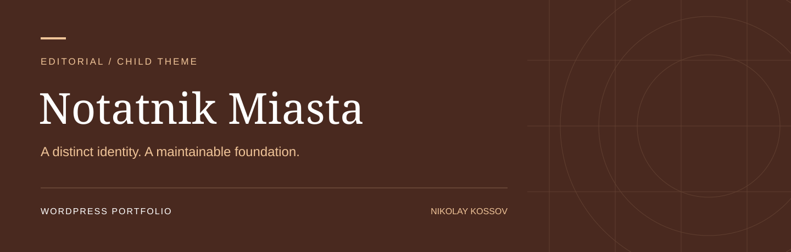
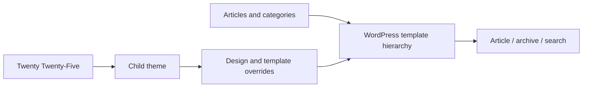

<div align="center">



# 📖 Notatnik Miasta

### A WordPress editorial experience — built by extending Twenty Twenty-Five

[](https://wordpress.org/)
[](https://www.php.net/)
[](themes/notatnik-miasta/style.css)
[](compose.yaml)
[](https://github.com/NikolayKossov/WordPress-Notatnik-Miasta/actions/workflows/check.yml)
[](LICENSE.md)

**Child theme · Editorial content · Archives & search**

[Explore the implementation](#-implementation-highlights) · [Run locally](#-quick-start) · [Recruiter snapshot](#-recruiter-snapshot) · [Русское руководство](docs/WALKTHROUGH-RU.md)

<sub>Portfolio demonstration · Fictional brand · Polish website content · English technical documentation</sub>

</div>

---

## 📑 Table of contents

- [Business problem](#-business-problem)
- [Recruiter snapshot](#-recruiter-snapshot)
- [Implementation highlights](#-implementation-highlights)
- [Architecture](#-architecture)
- [Design decisions](#-design-decisions)
- [Content and editor workflow](#-content-and-editor-workflow)
- [SEO and plugin handoff](#-seo-and-plugin-handoff)
- [Quick start](#-quick-start)
- [Quality and verification](#-quality-and-verification)
- [Repository structure](#-repository-structure)
- [Three-minute walkthrough](#-three-minute-walkthrough)
- [Scope and next steps](#-scope-and-next-steps)

---

## 🎯 Business problem

An editorial site needs its own identity, a simple publishing workflow and multiple ways to discover articles. Editing a vendor theme directly makes future updates difficult. This project demonstrates a child-theme approach with tailored templates, design settings and Polish editorial content.

> **Project objective:** Give a small publication a recognizable visual identity while preserving the parent theme as an independently updatable dependency.

The implementation addresses a practical junior WordPress brief: create a simple site, adapt its design, maintain its content and prepare a clear handoff. Commercial impact and conversion improvements have not been measured.

## 💼 Recruiter snapshot

| Capability | Evidence in this repository |
|---|---|
| Translate a brief into a site | [Client brief and acceptance criteria](docs/BRIEF.md) |
| Customize WordPress presentation | [Theme source](themes/notatnik-miasta/) and [design settings](themes/notatnik-miasta/theme.json) |
| Work with HTML and CSS | Semantic templates, responsive layouts and explicit keyboard focus styling |
| Prepare editable content | [Polish fixtures](content/demo.json), four pages and three categorized articles |
| Handle plugin configuration | [Configuration exercise](docs/PLUGINS.md) |
| Support basic SEO | [Metadata, indexing and sitemap checklist](docs/SEO.md) |
| Organize reviewable work | [Issue template](.github/ISSUE_TEMPLATE/client-change.md), [PR template](.github/pull_request_template.md) and [manual QA](docs/QA.md) |
| Document a technical handoff | English setup documentation and a [Russian learning walkthrough](docs/WALKTHROUGH-RU.md) |

The source demonstrates implementation choices. Collaboration templates and written English are supporting artifacts, not claims of commercial teamwork or spoken fluency.

## ✨ Implementation highlights

| Feature | What is implemented | Evidence |
|---|---|---|
| **Twenty Twenty-Five child theme** | An explicit Template declaration extends the upstream theme without editing its files. | [View source](themes/notatnik-miasta/style.css) |
| **Editorial template set** | Article, archive, search, posts index and empty-state templates. | [View source](themes/notatnik-miasta/templates/) |
| **Brand customization** | A warm palette, typography and layout overrides in the child theme. | [View source](themes/notatnik-miasta/theme.json) |
| **Structured starter content** | Three articles with excerpts and categories, plus four core pages. | [View source](content/demo.json) |
| **Editor handoff** | Russian walkthrough covering inheritance, database overrides and source-control boundaries. | [View source](docs/WALKTHROUGH-RU.md) |

Every project also includes an import script that preserves existing page content, a Docker environment and a GitHub Actions workflow. No page-builder subscription or front-end build tool is needed for the delivered theme.

## 🧭 Architecture



**Source files** define the theme and starter content. **The WordPress database** stores ongoing editorial changes. **Docker volumes** retain that database between runs. This boundary is documented so a Git commit is not mistaken for a complete site backup.

## 🛠 Design decisions

| Decision | Reason |
|---|---|
| **Child theme rather than upstream edits** | Keep project-specific changes isolated when updating Twenty Twenty-Five. |
| **Dedicated search and archive templates** | Treat content discovery as part of the editorial experience. |
| **Explicit editorial fixtures** | Make the starting content reproducible without publishing a database dump. |
| **Document Site Editor overrides** | Explain why database customizations can take priority over theme files. |
| System fonts | Avoid external font requests and keep local setup self-contained. |
| Demonstration data | Show a realistic content structure without publishing client data or invented testimonials. |

## ✍️ Content and editor workflow

1. Import the supplied starter content using the setup command.
2. Edit **Start**, **O nas** or **Kontakt** in the WordPress editor.
3. Update articles, excerpts and categories through the Posts screen.
4. Review the change at mobile and desktop widths.
5. Record acceptance evidence in an issue or pull request.

Open **Aktualności**, inspect an article and its category archive, then search for **plan**. Change an excerpt in the editor and explain which templates are supplied by the child theme.

The seed script adds missing content and preserves existing pages on repeat runs. Site Editor customizations may override files stored in Git; see [the walkthrough](docs/WALKTHROUGH-RU.md) before exporting changes.

## 🔎 SEO and plugin handoff

The repository includes a concrete [SEO checklist](docs/SEO.md): page titles, descriptions, heading hierarchy, permalinks, canonical tags, indexing, sitemaps and image alternatives.

- Local demo indexing is discouraged by default.
- Metadata is intended to be managed by **one** selected SEO plugin.
- [Plugin instructions](docs/PLUGINS.md) cover an SEO plugin and optional Contact Form 7 configuration.
- Third-party plugins are **not preinstalled**. Their setup and mail delivery tests remain a hands-on exercise.
- The theme does not hard-code competing SEO metadata.

No SEO ranking, email delivery or Lighthouse score is claimed without a corresponding test.

## 🚀 Quick start

**Prerequisites:** Git, Docker Desktop with Linux containers, Docker Compose and Internet access for image downloads.

```powershell
git clone https://github.com/NikolayKossov/WordPress-Notatnik-Miasta.git
cd WordPress-Notatnik-Miasta
Copy-Item .env.example .env
# Replace the three example passwords in .env before starting.
docker compose up -d wordpress
docker compose run --rm cli /portfolio/scripts/setup.sh
```

| Destination | Default URL |
|---|---|
| Website | http://localhost:8082 |
| WordPress admin | http://localhost:8082/wp-admin/ |
| Credentials | Values configured in your local `.env` |

On macOS/Linux, replace `Copy-Item .env.example .env` with `cp .env.example .env`. The first run downloads images and may take several minutes. The setup also downloads the Twenty Twenty-Five parent theme.

```powershell
# Re-run the WordPress smoke checks.
docker compose run --rm cli /portfolio/scripts/smoke.sh

# Stop containers; keep the database volumes.
docker compose down
```

See [full setup and non-Docker installation](docs/SETUP.md). GitHub hosts the source; **GitHub Pages does not execute WordPress/PHP**.

## 🧪 Quality and verification

**Verified on 2026-10-22:** [WordPress runtime and HTTP checks passed](https://github.com/NikolayKossov/WordPress-Notatnik-Miasta/actions/workflows/check.yml).

The [GitHub Actions workflow](.github/workflows/check.yml) is configured to:

1. Check PHP syntax.
2. Boot a fresh WordPress and MariaDB environment.
3. Run setup twice to exercise repeat imports.
4. Assert the active theme, required pages and front-page configuration.
5. Parse the imported block content.
6. Check the homepage, contact page, search route and HTTP 404 behavior.

The badge above links to the actual CI result. JSON parsing, block delimiter balance and package integrity were checked during local preparation. Visual rendering, editor behavior, manual accessibility testing and optional third-party plugin configuration require the [manual QA checklist](docs/QA.md). Automated smoke tests are not a comprehensive accessibility audit.

## 📂 Repository structure

```text
.
├── themes/notatnik-miasta/   # Theme, styling and templates
├── content/demo.json           # Polish starter pages and articles
├── scripts/                    # Setup, content import and smoke checks
├── docs/
│   ├── assets/cover.svg         # Original project identity banner
│   ├── BRIEF.md                # Client scenario and acceptance criteria
│   ├── SEO.md                  # SEO verification and handoff
│   ├── PLUGINS.md              # Plugin configuration exercise
│   ├── QA.md                   # Verification record
│   └── WALKTHROUGH-RU.md       # Russian explanation and interview preparation
├── .github/                    # CI, issue and PR templates
├── compose.yaml                # Local WordPress environment
└── .env.example                # Example settings; no live credentials
```

## 🎬 Three-minute walkthrough

| Time | Demonstration |
|---|---|
| 0:00–0:45 | Explain the client problem and show the homepage. |
| 0:45–1:30 | Make a visible content change through WordPress. |
| 1:30–2:15 | Show the project's distinctive implementation: child-theme inheritance and article discovery. |
| 2:15–3:00 | Show one source file, the CI result and a clearly documented limitation. |

## 🗺 Scope and next steps

This is an educational portfolio project, not a production client deployment. The brand is fictional; contact data is illustrative. The cover is a project identity graphic, not a screenshot of a deployed site.

- Complete browser/editor QA and attach real screenshots.
- Configure the selected SEO plugin and record its actual version.
- Connect and test mail delivery only if a real contact form is added.
- Add approved photographs and meaningful image alternatives when a real brief supplies them.
- For a production handoff, record exact dependency versions, backups and hosting configuration.

---

<div align="center">

**Part of a three-project WordPress portfolio**

[Zielony Serwis](https://github.com/NikolayKossov/WordPress-Zielony-Serwis) · [Studio Forma](https://github.com/NikolayKossov/WordPress-Studio-Forma)

Created for [Nikolay Kossov](https://github.com/NikolayKossov) · [GPL-2.0-or-later](LICENSE.md)

</div>
